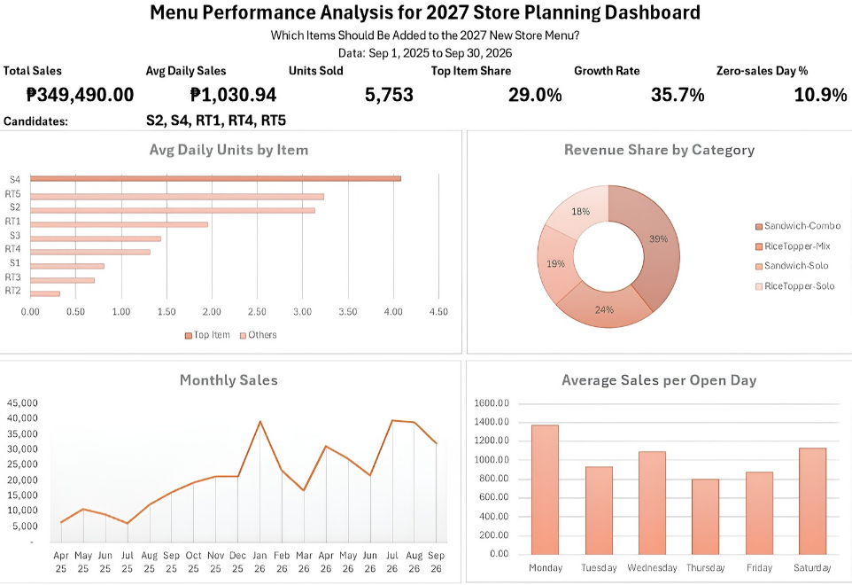

> **Part 1 of 3** in the Menu Performance Analysis for 2027 Store Planning. See also: [Part 2: SQL Menu Questions](https://github.com/joserodrigodiga/sql-menu-questions) | Part 3: Looker Studio dashboard (in progress)

# Excel Menu Performance Analysis

**Question:** Which items should be added to the 2027 new store menu?

**Data note:** Figures are scaled to protect the owner's financial information. Rankings, trends and shares reflect the real patterns.

## Tools
Excel (functions only)

## Method
- Checked the data (dates, item codes, categories, totals, no Sunday rows)
- Ranked sandwiches and rice toppers on average daily units, trend and consistency
- Compared sandwich w/ fries add-on and overload topper value

## Findings
1. Headline:
Based on sales from Sep 1, 2025 to Sep 30, 2026, the strongest candidates for the 2027 menu are S4 and S2 (sandwiches) and RT5, RT4, and RT1 (rice toppers).
Source: Ranking, column K.
2. Sandwiches:
S4 ranked first with 4.1 average daily units, selling on 55.2% of open days, with a trend of +26.9%.
S2 ranked second with 3.1 average daily units and a trend of +49.2%.
S3 and S1 ranked lower, at 1.4 and 0.8 average daily units.
Source: Ranking and Summary.
3. Rice toppers:
RT5 led with 3.2 average daily units and 42.5% consistency and a trend of +37.4%.
RT1 and RT4 followed, with consistency of 31% and 24.5%.
RT3 and RT2 ranked lowest at 0.7 and 0.3 average daily units.
Source: Ranking and Summary.
4. Add-on and Overload checks:
Fries add-on: Combos made up 58.3% of sandwich units, and the fries add-on is priced at 25. This suggests customers do often choose fries.
Overload (RT5): RT5 sold 202.3% more units per day than the average of RT1 to RT4, so the mix is worth keeping.
Source: Comparisons, Blocks 1 and 2.
5. Overall performance:
Total sales were 349,490 pesos, with average daily sales of 1,030.9 across 339 open days.
Sales per open day moved +35.7% between the prior period (Apr to Jun 2026) and the recent period (Jul to Sep 2026). S4 made up 29% of sales.
Source: KPI Calcs, Block 1.
6. Pattern:
Monday had the highest average sales per open day, and Thursday had the lowest.
January and July were the strongest months, which may be linked to New Year spending and the store anniversary.
7. Owner Insights:
The owner noted that customers ask for rice meals that is why they added rice toppers on the menu and those items are easy to prepare consistently.
8. Recommendation:
Include items S4, S2, RT5, RT4, and RT1 in the menu of the new store in 2027, pending a margin review. Keep item S3 on watch because of its rising trend of 79%.

## Dashboard

## Limitations
- No cost data: Items were ranked by sales performance, not pprofit.
- Data period: Sales end Sep 30, 2026. Items were compared from Sep 1, 2025, when all 9 were on the menu.
- Shorter rice topper history: Rice toppers launched in September 2025, so they have less history than sandwiches. Their early trend may include launch ramp-up.
- Store operations: Sundays and owner-confirmed closures were excluded. Days with no recorded sales were counted as open days with zero sales.
- Franchise influence: Sales of the franchised brand may affect these items' sales (for example, add-on purchases). This could not be measured.
- Candidates, not final decisions: Results are candidates for the 2027 menu, pending margin review, owner feedback, prep time, and ingredient availability.
- Figures are scaled to protect business data.

## Files
- `menu-analysis.xlsx`: full workbook
